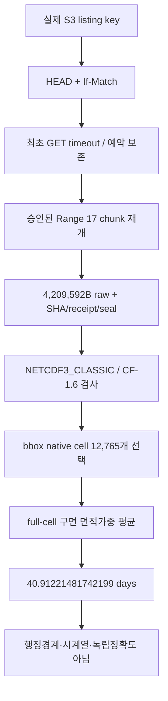

# v4.2 CCKP Indonesia 개발 bbox 수치 도구 이해자료

- updated_at: 2026-11-24 KST
- evidence_paths: `services/climate_query/`, `tests/climate_query/`, `docs/ai/climate/CCKP_INDONESIA_NUMERIC_TOOL.md`, `evidence/cckp_indonesia/`
- status: 고정 원본과 한정된 bbox 통계는 `VERIFIED_REAL`; 합성 12 + 실원본 read-only 재현 2 = 14 PASS; 서비스 live 등록·학습·배포는 `BLOCKED`이다.

## 1. 쉬운 설명

이제 CCKP 문서 검색이 숫자를 추측하는 대신, 실제 고정 NetCDF 원본을 읽어 **하나의 제한된 CDD 통계**를 재현할 수 있다.

검증된 값은 1951–1980 제공 CDD climatology의 개발 bbox `[95,-11,141,6]` 안 native 0.25° 셀 12,765개의 full-cell 구면 면적가중 평균 **40.91221481742199 days**다.

그러나 이 숫자는 다음이 아니다.

- 인도네시아 공식 행정경계 평균이 아니다. bbox에는 해양·이웃 국가가 포함될 수 있다.
- 연별 또는 월별 시계열이 아니다. 파일에 time 1개의 1951–1980 climatology만 있다.
- 독립 ground truth가 아니다. ERA5는 재분석 자료다.
- 학습 feature나 배포된 서비스 결과가 아니다. live tool 등록·학습·배포는 0건이다.

## 2. 이론적 배경

### Climatology와 시계열의 차이

Climatology는 특정 기준기간을 요약한 필드다. 이 원본은 `wb_period_label=1951-1980`, `time.climatology_period=1951-1980`, time 차원 1개다. 따라서 2010년 CDD나 월별 CDD를 역산할 수 없다. 요청 기간이 다르면 `CLIMATOLOGY_PERIOD_MISMATCH_NO_ANNUAL_VALUES_INFERRED`로 차단한다.

### bbox full-cell 가중 평균

셀 중심이 bbox 안에 들어오는 native grid를 선택하고, 실제 lat/lon bounds로 구면 셀 면적 비례 가중치를 계산한다. bbox 경계에 걸친 셀의 부분 면적을 잘라내지 않으며, 인도네시아 polygon으로 육지·해양을 구분하지 않는다. 그래서 결과 이름은 국가 평균이 아니라 `bbox_area_weighted_mean`이다.

### 재분석과 독립 ground truth

ERA5는 관측을 자료동화한 재분석 제품이다. 유용한 기후 자료지만 별도 현장 라벨과 독립적인 정확도 정답으로 자동 인정되지 않는다. 결과는 `data_role=ERA5_REANALYSIS`, `independent_accuracy_validated=false`를 보존한다.

## 3. 코드와 데이터 동작



### 원본 취득과 무결성

- 실제 원본: 4,209,592B
- SHA-256: `646fba633f7ca2d4cde8138209deb63b3fa4430bbc46e0be3288e6039f9b01f7`
- ETag: `"89a1fc4164f41e1db1e22e776918d4df"`; SHA-256으로 취급하지 않음
- 최초 body read timeout의 4,209,592B 예약을 환불하지 않음
- 명시 승인 후 If-Match와 256KiB 이하 Range 17개로 재개
- 완료 raw/receipt/seal 재사용은 HTTP 0건·0B로 검증

`evidence-manifest.json`은 원본, 17개 progress, receipt, metadata, bbox CSV, 결과의 크기와 SHA를 고정한다.

### NetCDF·수치 계약

실제 형식은 `NETCDF3_CLASSIC`, `Conventions=CF-1.6`, gregorian calendar, 0.25° rectilinear grid다. 변수는 `climatology-cdd-annual-max`, 단위 days이며 연간 1mm 미만 건조일의 최장 연속 길이 지수다. FillValue/NaN을 0으로 바꾸지 않는다.

`climate.query`는 geography/time/variable/observed_or_projected/model/scenario/aggregation/unit을 모두 요구한다. 서버가 고정한 raw SHA·receipt seal·license evidence·CF metadata가 일치할 때만 숫자를 반환한다. 임의 URL·로컬 경로·RAG 생성 숫자를 사용자 입력으로 받지 않는다.

### 검증 결과

| 항목 | 값 |
|---|---|
| bbox | `[95,-11,141,6]` |
| grid | 69×185, 12,765개 모두 유효 |
| 기간 | 제공된 1951–1980 CDD climatology |
| 집계 | native full-cell 구면 면적가중 평균 |
| 결과 | **40.91221481742199 days** |
| 행정경계 평균 | false |
| 독립정확도 | false |
| curated 등록·학습·배포 | false / 0건 |

## 4. 시험 증거

```powershell
python -X utf8 -m pytest tests/climate_query -q
python -X utf8 -m compileall -q services/climate_query tests/climate_query
```

결과는 **14 PASS**다.

- `TESTED_SYNTHETIC` 12: schema, 기간·모델·시나리오·단위, CF 누락, SHA/license, FillValue, Range partial, 재사용, 429 차단
- `VERIFIED_REAL` read-only 재현 2: 4,209,592B 원본 SHA/형식/CF/기간/12,765셀/수치 재현, HTTP 없는 원본 재사용

이 시험은 한 개 ERA5 CDD climatology 파일에 대한 실증이다. 다른 변수·기간·모델, 인도네시아 polygon 통계, 실제 서비스 요청, 학습·배포를 검증하지 않는다.

## 5. 발표 스크립트

### 1분

“CCKP 수치 도구는 실제 4.2MB NetCDF 원본을 SHA로 고정하고 17개 Range chunk로 취득해, 1951년부터 1980년까지 제공된 CDD climatology를 재현했습니다. 개발 bbox의 12,765개 native 셀을 full-cell 구면 면적가중한 값은 40.91221481742199일입니다. 다만 이것은 인도네시아 행정경계 평균도, 연별·월별 시계열도 아닙니다. ERA5 재분석은 독립 ground truth가 아니며, 이 도구의 live 서비스 등록·학습·배포는 아직 0건입니다.”

### 5분 핵심 순서

1. 국가 URL을 추측하지 않고 실제 listing의 global NetCDF 한 건을 사용했다.
2. 최초 timeout 예약을 보존하고 승인된 Range 17개로 재개했다.
3. 4,209,592B raw SHA와 receipt seal, CC-BY-4.0 catalog evidence를 고정했다.
4. `NETCDF3_CLASSIC`, CF-1.6, 1951–1980 climatology, 0.25° bounds를 파일에서 직접 검사했다.
5. bbox cell 12,765개의 full-cell 구면가중 평균은 40.91221481742199 days다.
6. 행정 polygon·부분셀 clip·연별/월별 추론·독립정확도는 수행하지 않았다.
7. 합성 12 + 실재현 2는 통과했지만 live 서비스·학습·배포는 0건이다.

## 6. Q&A

**Q. 인도네시아 국가 평균 CDD가 40.912일이라는 뜻인가?**

아니다. `[95,-11,141,6]` bbox의 셀 중심 선택 결과이며 해양·이웃 국가가 포함될 수 있다. 공식 행정경계 polygon 평균이 아니다.

**Q. 1951년부터 1980년까지 매년 평균한 값인가?**

원본이 제공한 단일 1951–1980 CDD climatology 필드의 공간 평균이다. 연별·월별 값을 읽거나 역산한 결과가 아니다.

**Q. ERA5이므로 독립 정확도 정답인가?**

아니다. ERA5는 재분석이며 독립 현장 ground truth가 아니다. 모델 정확도는 별도의 독립 라벨로 평가해야 한다.

**Q. 이제 모든 CCKP 수치 질문에 답할 수 있나?**

아니다. 현재 검증 범위는 이 한 파일·변수·기간·bbox 집계다. 다른 변수·기간·모델은 각 원본·CF·단위·license 계약이 필요하다.

**Q. 운영 API나 RAG에 등록됐나?**

아니다. 로컬 CLI/library와 증거만 검증했다. HTTP/RAG live tool 등록, curated 등록, 학습, 배포는 0건이다.
