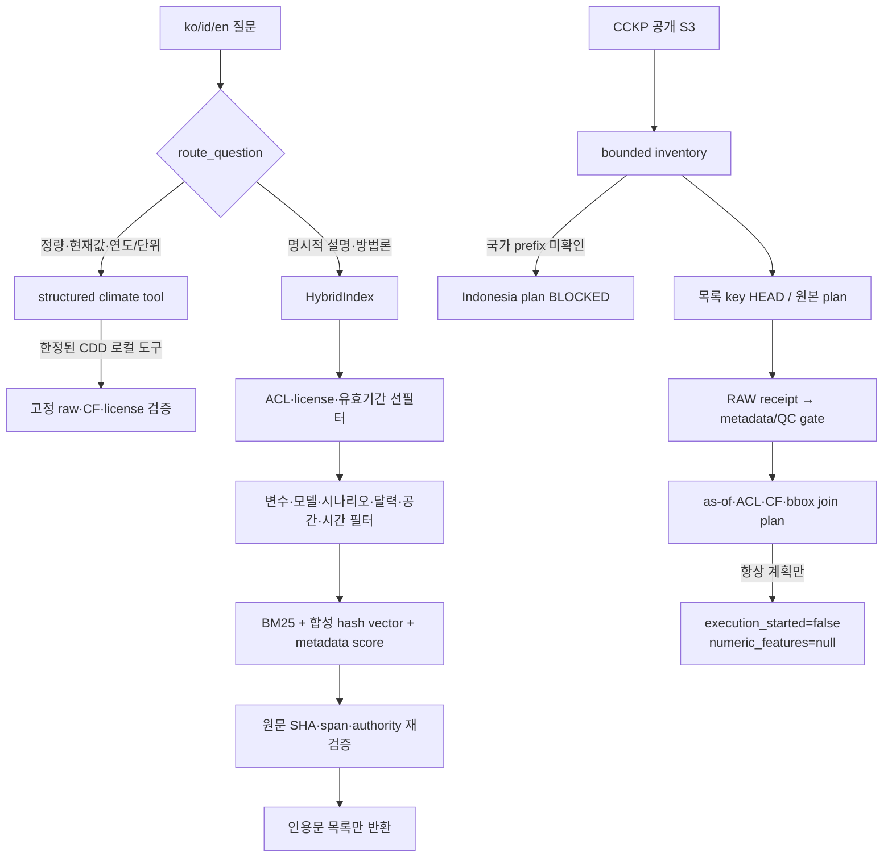

# v4.2 기후 데이터 계약과 근거 추적형 RAG 이해자료

- updated_at: 2026-11-24 KST
- source_commit: `UNCOMMITTED_BOOTSTRAP` (현재 브랜치에 아직 커밋 없음)
- evidence_paths: `docs/architecture/V42_EXECUTION_PLAN.md`, `services/contracts/climate.py`, `services/datahub/connectors/cckp/`, `services/datahub/climate/`, `services/geoai/features/`, `services/rag/`, 관련 `tests/`, `docs/ai/climate/`
- confidence: 완료 코드, 실제 CCKP 탐색·원본·numeric evidence와 시험을 직접 대조했다. `VERIFIED_REAL` 수치는 한 개 ERA5 CDD climatology 원본과 개발 bbox 집계에만 적용한다.
- status: CCKP 제한형 탐색과 한 개 ERA5 CDD bbox 통계는 `VERIFIED_REAL`; source/lake/feature/RAG 계약은 `TESTED_SYNTHETIC`; 행정경계 통계·일반화된 수치 API·운영 서비스는 `BLOCKED` 또는 `PLANNED`; 전체 v4.2는 `IMPLEMENTED_UNVERIFIED`이다.

## 1. 쉬운 설명

v4.2의 핵심은 **기후 숫자를 검색 문서의 비슷한 문장에서 만들어 내지 않고, 검증된 표·격자·데이터베이스 도구에서만 가져오도록 길을 나누는 것**이다.

도서관에 비유하면 두 창구가 있다.

- “강수량이 무엇인가?”, “SSP245 방법론은 무엇인가?” 같은 설명 질문은 근거 문서 창구가 원문 인용을 찾아준다.
- “2050년 인도네시아 강수량은 몇 mm인가?” 같은 수치 질문은 문서 창구가 답하지 않고 구조화 기후 도구 창구로 보낸다.

현재는 두 창구를 구분하는 규칙, 제한형 CCKP 탐색·취득, 원본 receipt, CF 달력·단위 검사, 미래누출 방지형 공간 조인 계획, 접근권한, 인용 검증까지 구현했다. 이후 실제 4,209,592B ERA5 CDD NetCDF를 SHA로 고정해 1951–1980 제공 climatology의 개발 bbox 평균 40.91221481742199 days를 재현했다. 단, 인도네시아 행정경계 평균·연별/월별 시계열·독립 정확도가 아니며 live 서비스·학습·배포는 0건이다.

## 2. 이론적 배경

### 데이터 lineage

Lineage는 “이 숫자나 문장이 어디에서 왔고 어떤 버전과 변환을 거쳤는가”를 추적하는 계보이다. `AssetLineage`는 source/dataset/version/URI/SHA-256/license/acquired_at과 공간·시간·단위·달력·관측/전망·모델·시나리오·접근권한·trace를 함께 보존한다.

전망값은 모델과 시나리오가 없으면 실패한다. 관측값에 시나리오가 붙어도 실패한다. `360_day`, `noleap` 같은 CF(Climate and Forecast) 달력은 Gregorian 달력으로 몰래 바꾸지 않는다. coarse climate grid를 Sentinel-2 10m 관측처럼 표현하지 않는다.

### RAG와 구조화 수치 도구의 분리

RAG(Retrieval-Augmented Generation)는 문서 근거를 찾아 설명할 때 유용하지만, 벡터 유사도는 수치 사실 검증 도구가 아니다. 따라서 `ClimateQuery.route`와 `route_question()`이 설명 검색과 정량 도구를 분리한다.

`CanonicalResult`는 성공 응답에 citation을 요구하고, numeric payload는 `structured_climate_tool` 경로에서만 허용한다. Knowledge RAG가 숫자 payload를 반환하려 하면 계약 검증에서 실패한다.

### 온톨로지와 지식그래프

온톨로지는 자료 종류와 관계의 허용 범위를 명시한다. 구현은 Institution, Source, DatasetVersion, Variable, Scenario, ClimateModel, Geography, Document, Chunk 등 16개 노드 타입과 PUBLISHED_BY, HAS_VERSION, DERIVED_FROM, CITES 등 11개 관계를 정의한다.

모든 노드와 관계는 등록 원문의 정확한 문자 범위, SHA-256, 버전, authority에 결속된다. 이 검사는 “기록한 원문과 일치한다”는 뜻이지, 입력 authority가 실제 기관인지 또는 내용이 과학적으로 참인지 자동 인증하는 것은 아니다.

### ACL 선필터

ACL(Access Control List)은 점수를 계산하기 전에 적용한다. 제한 문서를 먼저 제외하므로 비공개 문서가 공개 검색의 IDF나 순위를 바꾸는 통계 누출을 줄인다. 다만 실제 로그인·토큰·기관 role 발급과 timing side-channel 검증은 아직 없다.

### as-of와 미래 누출

학습 시점에 알 수 없던 최신 자료·경계·정규화 통계를 과거 학습행에 섞으면 미래 누출이 생긴다. 그래서 climate asset의 `available_at`, 경계의 유효기간과 공개시각, feature cutoff, 관측/전망 역할, 부모 lineage의 fit 기간을 함께 확인해야 한다. 현재 구현은 불명확하면 실행하지 않는 fail-closed 계획기이며 실제 수치 조인을 수행하지 않는다.

## 3. 코드와 데이터 동작



### CCKP 제한형 source 커넥터

`services/datahub/connectors/cckp/source.py`는 `wbg-cckp` 공개 bucket의 반환된 prefix만 한 페이지씩 탐색한다. 자동 재귀·전역 sync·국가 코드 추측을 금지하고, XML 원문 SHA, URI, 취득시각, truncation, key/size/ETag를 고정한다. 목록에 실제 존재한 key만 HEAD/GET 후보가 된다. 계획은 최대 20파일·64MiB, 객체당 32MiB이며, ETag/Range/receipt pin/부분파일 SHA/영속 예산/lock/429 circuit을 검사한다.

실제 확인 범위는 다음뿐이다.

- `VERIFIED_REAL`: root부터 ERA5 CDD historical까지 S3 목록 5페이지, 응답 XML 합계 5,289B
- `VERIFIED_REAL`: 목록의 NetCDF 1건 HEAD 200, 크기 4,209,592B와 ETag 일치
- `BLOCKED`: Indonesia 식별자 또는 국가별 prefix가 목록에서 확인되지 않아 download plan 없음
- `VERIFIED_REAL`: 후속 승인 Gate에서 4,209,592B 원본을 Range 17개로 취득하고 SHA·CF·NETCDF3_CLASSIC을 검증
- `VERIFIED_REAL`: 1951–1980 CDD climatology bbox full-cell 구면가중 평균 40.91221481742199 days
- `BLOCKED`: 인도네시아 행정경계 평균, 연별/월별 값, 일반화된 live 수치 서비스

ETag는 SHA-256으로 간주하지 않는다. 합성 fixture의 `country/IDN/`은 안전계약 시험용이지 실제 CCKP 구조의 증거가 아니다.

### Climate lake와 feature 계획

`services/datahub/climate/`는 `ClimateAsset`의 고정 식별자, URI, SHA, license, available_at, 관측/전망, 모델/시나리오, CF 달력, 단위, 격자, CRS, 부모 lineage, ACL을 검증한다. RAW receipt에 필드가 없으면 `CLIM_METADATA_MISSING`으로 차단한다. metadata 검사가 성공해도 `numeric_values_verified=false`이며 curated 승인이나 실제 NetCDF QA를 뜻하지 않는다.

`services/geoai/features/climate_join.py`는 asset·경계·요청의 as-of, 유효기간, cutoff, ACL, 달력, CRS, bbox 교차, native grid candidate window만 계산한다. polygon 교차·면적가중·zonal statistics·downscaling은 실행하지 않는다. 모든 허용 결과도 `status=PLANNED`, `execution_started=false`, `numeric_features=null`이다. coarse grid를 Sentinel-2 10m 관측처럼 표현하지 않는다.

### 공통 계약

`services/contracts/climate.py`:

- `SpatialCoverage`: WGS84 bbox 순서·범위를 검증한다.
- `TimeCoverage`: 시작/종료와 CF 달력을 고정한다.
- `AccessPolicy`: restricted/private이면 allowed roles가 필수다.
- `AssetLineage`: 관측/전망 의미, 모델·시나리오, CRS 일치를 검사한다.
- `ClimateQuery`: 구조화 수치 질문에 변수와 기간을 요구한다.
- `EvidenceCitation`: source/dataset/version/URI/span/authority를 보존한다.
- `CanonicalResult`: 성공에는 citation이 필요하고 RAG numeric payload를 금지한다.

### RAG 코어

`services/rag/ontology.py`는 원문 본문 SHA와 Unicode 문자 범위 `[start,end)`를 검증한다. relation domain/range, dangling edge, 중복 관계, SUPERSEDES의 같은 타입·다른 entity version, authority 결속을 검사한다.

`services/rag/retrieval.py`는 chunk metadata에 언어, ACL, 라이선스, 유효기간, 공간·시간, 변수, 모델, 시나리오, 관측/전망, 단위, 달력, 격자, dataset/version, trace를 요구한다. 검색 순서는 다음과 같다.

1. ACL·라이선스·유효기간·취득일 필터
2. 변수·시나리오·모델·관측/전망·달력·언어·bbox·연도 필터
3. 허용 자료만으로 BM25 계산
4. BM25 0.45 + 합성 hash vector 0.35 + metadata 0.20
5. 동일 점수는 chunk ID로 결정적 정렬
6. 현재 질의 조건으로 citation을 다시 검증

64차원 hash vector는 실제 다국어 embedding이 아니라 재현 가능한 `TESTED_SYNTHETIC` 시험 장치다. 의미 검색 성능이나 운영 품질을 증명하지 않는다.

`services/rag/routing.py`는 강수량·기온·최고/최저기온·풍속·상대습도의 한국어/인니어/영어 alias를 정규화한다. 정량 질문은 RAG로 fallback하지 않고 `climate.query` 도구 필요 상태를 반환한다. 이 도구 ID는 adapter 계약이며 실제 API가 존재한다는 뜻은 아니다.

## 4. 테스트 증거

2026-11-24 작업 루트 `E:\SDSS-Platform2`에서 실행했다.

```powershell
python -X utf8 -m pytest tests/contracts tests/rag tests/datahub tests/climate_lake tests/climate_features -q
python -X utf8 -m compileall -q services/contracts services/rag services/datahub/connectors/cckp services/datahub/climate services/geoai/features
```

결과는 영역별 합계 **71 PASS**다.

- 공통 계약 5개: 전망의 model/scenario 필수, 관측의 scenario 거부, CF 달력·timezone, 수치 질의 필수 slot, RAG numeric payload 금지
- RAG 18개: 16노드·11관계, 위조 span/SHA/authority 차단, ACL 선필터, license/만료, 공간·시간·달력 필터, 결정적 ranking, 인용 재검증, ko/id/en alias, 정량 질문의 tool-only route
- CCKP source 24개: 국가 URL 추측·XML entity·경로이탈·범위/수량/바이트/기간·ETag/Range·receipt/partial pin·영속예산·429 circuit·lock 차단
- climate lake 12개: CF 달력·단위 차원/기간변환·projection 의미·고정 버전/URI·RAW metadata 차단·경로 제한
- climate feature 12개: 경계/자료 as-of·직접/간접 미래누출·ACL·projection role·CRS·bbox cell edge·위도축 방향

이 71개 시험은 모두 합성 문서·fixture 기반 `TESTED_SYNTHETIC`이다. 이후 별도 climate.query Gate에서 실제 4,209,592B 원본과 CDD bbox 수치를 read-only 재현 2건으로 검증했다. 이 제한 실증은 실제 행정경계 join/numeric feature, 모델 학습·배포, semantic embedding, 기관 인증, 독립 과학 정확도를 검증하지 않는다.

### Gate 상태

| Gate | 상태 | 근거/남은 일 |
|---|---|---|
| CLIM-01 공통 metadata·lineage | `TESTED_SYNTHETIC` | Pydantic 계약 5 PASS; 운영 ingestion 미연결 |
| CLIM-02 CCKP inventory/discovery | `VERIFIED_REAL` / `BLOCKED` | 목록 5페이지 5,289B와 HEAD 1건만 실제 확인; Indonesia prefix 미확인 |
| CLIM-03 immutable RAW receipt | `VERIFIED_REAL` / `TESTED_SYNTHETIC` | 한 NetCDF 4,209,592B·17 Range·SHA/receipt 검증; 일반 계약 24 PASS |
| CLIM-04 CF 달력·단위·관측/전망 QC | `VERIFIED_REAL` / `TESTED_SYNTHETIC` | 한 CDD 원본 CF-1.6·NETCDF3_CLASSIC·기간/단위 검증; 일반 lake 계약 12 PASS |
| CLIM-05 시공간 feature join | `TESTED_SYNTHETIC` | planner 12 PASS; 실제 join 0, `execution_started=false`, `numeric_features=null` |
| CLIM-06 ontology/KG/ACL/citation | `TESTED_SYNTHETIC` | 실제 문서/identity provider 미연결 |
| CLIM-07 hybrid retrieval/tool routing | `VERIFIED_REAL` / `TESTED_SYNTHETIC` | 한 CDD bbox 로컬 tool 14 PASS; 운영 embedding·live 등록은 BLOCKED |
| CLIM-08 통합 인수·운영 인계 | `BLOCKED` | 실제 원천·API/UI·보안·운영 검증 필요 |

## 5. 발표 스크립트

### 1분

“v4.2에서는 기후 설명과 숫자의 답변 경로를 분리하고, 실제 CCKP 원본 한 건을 SHA로 고정해 CDD bbox 통계를 재현했습니다. 1951–1980 climatology의 12,765개 native 셀 구면가중 평균은 40.91221481742199일입니다. 하지만 인도네시아 행정경계 평균이나 연별·월별 시계열이 아니고 ERA5는 독립 ground truth가 아닙니다. live 서비스·학습·배포는 0건이므로 전체 완료는 아닙니다.”

### 5분 핵심 순서

1. 문제: 벡터 유사도가 숫자 사실과 기관 authority를 보증하지 않는다.
2. 계약: 출처 URI·버전·SHA·단위·달력·관측/전망·모델·시나리오를 fail-closed로 고정한다.
3. 설명 경로: ACL 선필터 후 BM25·합성 vector·metadata로 순위를 만들고 원문 citation을 재검증한다.
4. 정량 경로: `climate.query`가 고정 raw·CF·license가 맞는 한 CDD bbox 통계만 반환한다.
5. source/lake/feature: bounded 목록·receipt·CF/as-of/ACL 계약은 fail-closed이며 일반 feature planner 숫자는 여전히 null이다.
6. 증거: 기존 합성 71과 별도로 climate.query 합성 12 + 실재현 2가 통과했다.
7. 한계: 검증값은 행정경계 평균·연별/월별 시계열·독립 ground truth가 아니며 live 서비스·학습·배포는 0건이다.

## 6. Q&A

**Q. 이제 CCKP의 실제 2050년 강수량을 답할 수 있나?**
아니다. 실제 검증 범위는 1951–1980 CDD climatology의 한정된 bbox 통계뿐이다. 2050년 강수량은 해당 변수·기간·모델의 검증 원본 없이는 답하지 않는다.

**Q. CCKP 연동이 실제로 된 것은 무엇인가?**
공개 S3 목록과 HEAD 이후, 실제 global ERA5 CDD NetCDF 4,209,592B를 Range 17개로 취득하고 SHA·CF·기간·단위를 검증했다. 국가 object가 아니라 global grid에서 개발 bbox를 선택한 것이며 행정경계 평균은 아니다.

**Q. feature join 결과를 모델에 바로 쓸 수 있나?**
아니다. 현재는 bbox 기반 native cell 후보를 계획하고 누출·ACL·달력·CRS를 검사할 뿐이다. `execution_started=false`, `numeric_features=null`이며 실제 공간 조인·학습·배포는 0건이다.

**Q. 71개 시험 통과가 기후 정확도 검증인가?**
아니다. schema, 차단, ACL, citation, routing의 합성 계약시험이다. 실제 수치·모델 전망·독립 정확도 검증이 아니다.

**Q. Vector RAG가 비슷한 문서에서 숫자를 찾아주면 안 되나?**
유사도는 문맥 후보를 찾는 점수일 뿐 단위·달력·격자·시나리오가 맞는 수치인지 보증하지 못한다. 숫자는 구조화 도구만 반환해야 한다.

**Q. authority 필드가 있으면 공식 기관 승인이 확인된 것인가?**
아니다. 코드가 원문 span과 같은 authority 문자열인지 확인할 뿐, 그 문자열의 실제 기관 소유권·법적 효력·승인은 별도 검증 대상이다.

**Q. hash vector는 실제 embedding인가?**
아니다. 외부 모델 없이 재현성을 시험하기 위한 합성 feature hashing이다. 다국어 의미 검색 품질은 검증하지 않았다.

**Q. WorldCover 2021로 다른 연도의 독립 정확도를 계산할 수 있나?**
안 된다. WorldCover는 약한 참조이며 타 연도의 독립 정답이 아니다. 기관 참조 일치도와 독립 현장 정확도를 분리한다.

**Q. UI나 운영 서비스가 실행 중인가?**
이 근거 범위에는 API/UI 연결과 운영 서비스 검증이 없다. Python 내부 계약과 합성 시험 단계다.

모르는 질문에는 “현재 코드와 시험은 그 항목을 검증하지 않았습니다. 필요한 공식 원천·권한·실행 증거를 확보한 뒤 갱신하겠습니다”라고 답한다.
