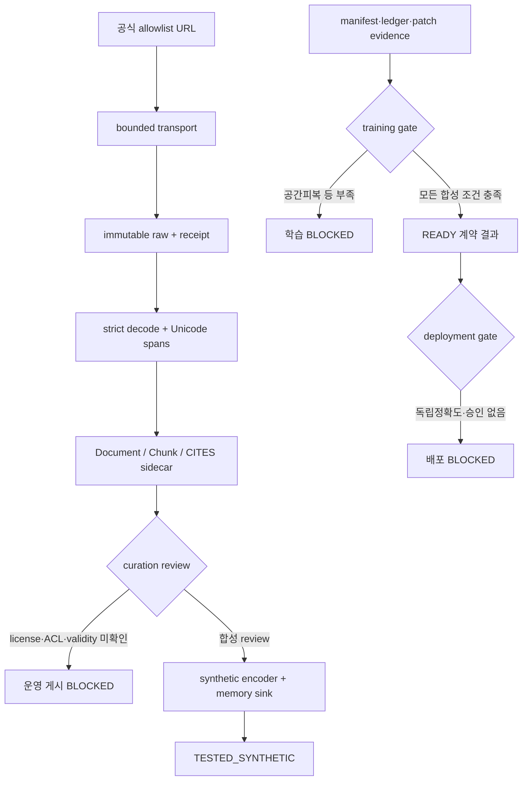

# v4.2 KLHK 문서 ingestion과 학습·배포 Gate 이해자료

- updated_at: 2026-11-24 KST
- evidence_paths: `services/datahub/connectors/klhk/`, `services/rag/ingestion/`, `services/mlops/`, 관련 `tests/`, `docs/ai/climate/KLHK_RAG_INGESTION.md`, `docs/mlops/TRAINING_ACCURACY_DEPLOYMENT_GATES.md`, `evidence/klhk_rag/`
- status: 제한된 원본 취득은 `VERIFIED_REAL`; ingestion·MLOps 계약은 `TESTED_SYNTHETIC`; KLHK native 23-class·license, 운영 index, 기관 authority, 실제 학습·독립정확도·배포는 `BLOCKED`이다.

## 1. 쉬운 설명

이번 Gate는 두 가지 안전장치를 추가했다.

첫째, KLHK와 CCKP의 공식 metadata·문서를 받을 때 원문과 SHA-256을 고정하고, 어디에서 언제 받았는지 receipt로 남긴다. 실제로 원본 7개, Unicode 문자 span 122개, 총 전송 본문 381,676B를 확인했고 원본 SHA 불일치는 0건이었다. 그러나 “공식 host에서 받았다”는 사실은 기관이 내용을 인증했다거나 재사용 license를 승인했다는 뜻이 아니다. 그래서 운영 RAG 게시 건수는 0이다.

둘째, 패치 수가 많다는 이유만으로 학습·배포하지 않도록 Gate를 둔다. 6개 주·36개 주-연도 셀, 6밴드와 SCL, 공간피복·유효픽셀, split 누출, 원본 SHA가 모두 맞아야 학습 Gate를 통과한다. 배포는 별도의 독립 지상정답, 보안검사, rollback 시험, 운영자 승인이 더 필요하다. 현재 실제 학습·독립정확도·배포는 모두 0건이다.

## 2. 이론적 배경

### 접근성·authority·license는 서로 다르다

HTTPS 공식 host에서 metadata를 받았다는 것은 **접근성** 증거다. 원문 SHA와 URI를 고정하면 **무결성·재현성**을 높일 수 있다. 하지만 이 두 사실은 기관의 전자서명이나 법적 **authority**, 또는 데이터 재사용 **license** 승인을 자동 보증하지 않는다. 그래서 receipt는 `HOST_PINNED_NOT_INSTITUTION_CERTIFIED`, `license=NOT_VERIFIED`, `retrieval_permitted=false`를 유지한다.

### 원문과 span 기반 RAG

RAG 문서는 raw byte → strict UTF-8 text → Unicode `[start,end)` span → Document/Chunk/CITES 그래프로 이어진다. HTML은 script/style을 제외한 추출 text의 문자 offset을 사용한다. 원문 SHA, 추출 text SHA, parser version을 따로 보존하므로 HTML byte offset과 추출문자 offset을 혼동하지 않는다.

운영 게시 전에는 reviewer, license 근거 URI, access·validity 검토가 필요하다. 합성 hash encoder와 memory sink는 계약 시험 도구일 뿐 운영 embedding 품질이나 vector DB 가용성을 증명하지 않는다.

### 약한 참조와 독립 정확도

WorldCover 2021, KLHK, Esri, Dynamic World와의 일치도는 연도·출처·독립성에 따라 약한 참조 지표일 수 있다. `weak_reference` 또는 `pseudo_label`은 점수가 높아도 배포 Gate를 열지 못한다. 독립 정확도는 공간적으로 분리되고 같은 시점에 맞춰졌으며 학습 라벨과 다른 원천의 현장·전문가 라벨로 평가해야 한다. WorldCover 2021을 다른 연도의 독립 정답으로 쓰지 않는다.

## 3. 코드와 데이터 동작



### KLHK bounded connector

`services/datahub/connectors/klhk/source.py`는 KLHK 계열과 World Bank repository의 정확한 host/path allowlist만 허용한다. redirect, secret query, 대량 URL 추측을 거부하며 기본 상한은 12요청·총 2MiB·문서당 256KiB·8초다. raw와 receipt는 URL+본문 SHA 기반으로 한 번만 게시하고 기존 원본·receipt 충돌과 변조를 차단한다.

실제 취득 결과는 다음처럼 제한해 해석한다.

| 항목 | 상태 | 해석 |
|---|---|---|
| CCKP repository metadata·commit·file list·README·LICENSE 5개 | `VERIFIED_REAL` | 원본 접근·SHA 보존. repository LICENSE를 모든 S3/data license로 확장하지 않음 |
| KLHK 2024·2025 layer metadata 2개 | `VERIFIED_REAL` | 연도와 Feature Layer metadata 접근 확인 |
| 원본 합계 | `VERIFIED_REAL` | 7개, 122 span, 실제 connector 본문 381,676B, raw SHA mismatch 0 |
| KLHK renderer | `BLOCKED` | 각 25항목이며 native 23-class coded domain으로 임의 축소하지 않음 |
| KLHK license·Query/download 허용 | `BLOCKED` | metadata 공개와 사용허가를 분리 |
| 기관 authority | `BLOCKED` | host pinning은 기관 인증서가 아님 |
| 운영 RAG 게시 | `BLOCKED` | public index publication 0, quantitative RAG answer 0 |

KLHK 2021 endpoint는 `SOURCE_REQUEST_FAILED:URLError`, 공식 사전 runtime 취득은 timeout 후 bounded 재시도에서 크기 초과로 차단됐다. 이를 성공한 원본으로 기록하지 않는다.

### RAG ingestion

`stage_document()`는 신뢰 raw root 내부 `.raw`, 최대 512KiB, receipt SHA와 실제 파일 SHA 일치를 요구한다. `ingest_curated()`는 `CurationReview`, 원문 span과 `ChunkMetadata` 결속, 취득시각, license, ACL·validity, vector 차원·유한값을 모두 검사한 뒤 sink를 한 번만 호출한다. 외부 network encoder는 차단한다.

실제 원본 7개는 stage/KG sidecar까지만 보존됐다. 실제 문서용 curated metadata를 임의 생성하지 않았고 운영 embedding/index에 게시하지 않았다. 합성 시험에서만 `SyntheticHashEncoder`와 `MemoryVectorSink`를 사용했다.

### 학습·배포 Gate

`services/mlops/gates.py`의 training Gate는 6개 주, 36개 주-연도 셀, 공간피복 95% 이상, 유효픽셀 80% 이상, 1,000개 이상 적격 패치, train/validation/test 최소수량, B02/B03/B04/B08/B11/B12와 SCL, 원본 검증, split 합계·공간/장면 group·미래누출을 검사한다.

현재 실측 공간피복 입력 7.711080%는 `SPATIAL_COVERAGE_INSUFFICIENT`로 학습을 차단한다. 합성 fixture가 `READY`를 반환하는 시험은 Gate 논리의 양성 경로를 검증할 뿐 실제 데이터 준비나 학습 승인이 아니다.

deployment Gate는 training Gate, 독립 ground truth 표본·macro-F1·overall accuracy·공간 holdout·동년 정합·라벨원천 분리, 보안검사, rollback, 운영자 승인을 요구한다. 약한 참조 점수는 진단 정보로만 반환하고 배포를 허용하지 않는다.

## 4. 시험 증거

```powershell
python -X utf8 -m pytest tests/klhk_rag_ingestion tests/rag tests/mlops -q
python -X utf8 -m compileall -q services/datahub/connectors/klhk services/rag/ingestion services/mlops
```

- KLHK/RAG ingestion 신규 11 + 기존 RAG 18 = **29 PASS**, `TESTED_SYNTHETIC`
- MLOps Gate **6 PASS**, `TESTED_SYNTHETIC`
- 실제 원본 7개·122 span·381,676B, raw SHA mismatch 0은 `VERIFIED_REAL`

합성시험은 host/path pin, 예산·429, immutable raw/receipt, UTF-8 span, review/license/ACL, invalid vector와 외부 encoder 차단, 약한 참조 배포 거부를 확인한다. 실제 KLHK native 23-class, license, embedding 품질, 기관 authority, 실제 학습·독립정확도·배포를 검증하지 않는다.

## 5. 발표 스크립트

### 1분

“이번 Gate에서는 KLHK·CCKP 문서를 받을 때 원문과 SHA를 고정하고, 검토되지 않은 자료가 운영 RAG나 모델 배포로 넘어가지 못하게 했습니다. 실제로 metadata 원본 7개와 122개 span, 381,676바이트를 보존했고 SHA 불일치는 없었습니다. 하지만 KLHK layer의 renderer는 25항목이고 native 23클래스 domain과 license가 확인되지 않아 게시와 학습은 차단했습니다. ingestion 29건과 MLOps 6건의 합성시험은 통과했지만 실제 학습·독립정확도·배포는 아직 수행하지 않았습니다.”

### 5분 핵심 순서

1. 실제 증거: 원본 7개, 122 span, 381,676B, SHA mismatch 0.
2. 경계: 접근 가능성·원문 무결성과 기관 authority·license를 구분한다.
3. ingestion: immutable raw/receipt → strict text/span → KG sidecar → review 후 index 순서다.
4. KLHK 한계: 2024/2025 metadata는 실제지만 renderer 25항목이며 native 23-class와 license는 차단 상태다.
5. MLOps: 패치수뿐 아니라 공간피복, SCL, split 누출, 독립 ground truth, 보안·rollback·승인을 요구한다.
6. 시험: ingestion/RAG 29 + MLOps 6 합성 PASS.
7. 남은 일: 운영 embedding/index, 기관 authority, 실제 학습·독립정확도·배포다.

## 6. Q&A

**Q. KLHK 23개 토지피복 클래스를 확보했나?**  
아니다. 2024·2025 layer metadata와 연도는 실제 확인했지만 renderer는 25항목이고 native 23-class coded domain은 확인되지 않았다. 임의 trim·재분류하지 않는다.

**Q. 공식 host에서 받았으니 공식 정답인가?**  
아니다. host 접근과 SHA 보존은 원본 접근성·무결성 증거다. 기관 authority, license, 내용의 과학적 진실, 독립 ground truth는 별도 검증 대상이다.

**Q. 원본 7개가 운영 RAG에서 검색되나?**  
아니다. staging과 KG sidecar만 보존했으며 public index publication은 0이다. license·ACL·validity와 실제 embedding/index가 승인돼야 한다.

**Q. MLOps 시험에서 READY가 나왔으니 학습 가능한가?**  
아니다. READY 양성 경로는 합성 fixture다. 현재 실측 공간피복 7.711080%는 training Gate에서 차단되며 실제 학습도 0건이다.

**Q. WorldCover 2021 점수가 높으면 배포 가능한가?**  
아니다. WorldCover는 약한 참조이며 타 연도 독립 정답이 아니다. 코드도 `weak_reference`를 독립 정확도로 인정하지 않고 배포를 차단한다.

**Q. 독립 정확도에는 무엇이 필요한가?**  
학습 라벨과 다른 원천, 공간 holdout, 동년 정합, 충분한 표본, 평가보고서 SHA와 macro-F1/OA가 필요하다. 현재 실제 독립 평가 결과는 없다.

**Q. 지금 배포된 모델이 있나?**  
없다. 실제 모델 artifact, registry, 보안검사, rollback 시험, 운영자 승인과 배포 실행 근거가 없다.

