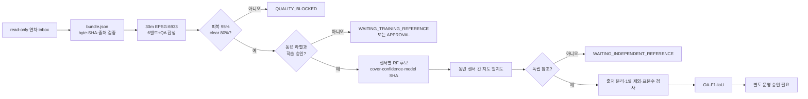

# LCLUC 연차 원본 입고·후보 모델·검증 Gate

- updated_at: 2026-11-26 KST
- source_commit: `b8a8c52` + uncommitted worktree
- evidence_paths:
  - `docs/lcluc/ANNUAL_INTAKE.md`
  - `services/lcluc/annual_inputs.py`
  - `services/lcluc/annual_rasters.py`
  - `services/lcluc/annual.py`
  - `services/apps/annual_worker.py`
  - `services/api/lcluc_annual.py`
  - `frontend/src/LclucAnnualIntake.tsx`
  - `deploy/kubernetes/annual-worker.yaml`
  - `artifacts/deploy/annual-docker-e2e.log`
  - `artifacts/deploy/annual-docker-browser-final.log`
  - `artifacts/deploy/annual-docker-restart.log`
  - `artifacts/deploy/annual-kube-e2e.log`
  - `artifacts/deploy/annual-kube-restart.log`
  - `artifacts/deploy/annual-docker-browser.png`
  - `artifacts/deploy/annual-kubernetes-browser.png`
  - `artifacts/deploy/annual-regression.log`
- confidence: 코드·격리 합성 Docker/Kubernetes E2E `HIGH`; 실제 2026 과학 결과 `NOT AVAILABLE`
- status: `TESTED_SYNTHETIC`

## 1. 쉬운 설명

### 한 문장으로

연차 Gate는 새해의 Sentinel-2·Landsat 원본을 **출처와 SHA가 고정된 한 묶음으로 접수**하고, 품질을 통과한 경우에만 센서별 Random Forest 후보와 검증 결과를 만들도록 설계한 안전한 입구다.

### 왜 필요한가

연차 자료는 단순히 폴더에 복사했다고 사용할 수 없다. 장면·밴드·연도·축척·품질 마스크가 서로 맞지 않으면, 지도는 만들어져도 재현할 수 없거나 잘못된 변화를 보여 줄 수 있다. 그래서 이 Gate는 다음을 먼저 묻는다.

1. 원본 파일의 길이와 SHA-256이 명세와 같은가?
2. Sentinel-2 여섯 밴드와 SCL, Landsat 여섯 밴드와 QA_PIXEL이 모두 있는가?
3. 장면 연도와 번들 연도가 같은가?
4. 30m 동일 격자에서 물리 피복 95%와 유효 픽셀 80%를 넘는가?
5. 학습 라벨과 학습 승인이 같은 입고 run에 결속됐는가?
6. 약한 참조 일치도와 독립 정확도를 서로 다른 칸에 기록했는가?

현재 코드는 이 흐름을 구현했고, 격리 합성 2026 반텐 번들로 Docker 5180과 로컬 kind Kubernetes 5181의 전체 상태 전이를 각각 실행했다. 그러나 **실제 2026 원본 번들과 독립 참조는 아직 없다.** 따라서 `TESTED_SYNTHETIC`은 런타임 경로 검증이며 실제 2026 분석 완료나 독립 정확도를 뜻하지 않는다.

### 네 종류의 숫자를 섞지 않는다

| 숫자 | 답하는 질문 | 독립 정확도인가? |
|---|---|---|
| 원본 품질 | 여섯 밴드가 물리적으로 있고 QA상 유효한가? | 아니오 |
| 동년 센서 간 지도 일치도 | 같은 해 Sentinel 후보와 Landsat 후보가 얼마나 같은가? | 아니오 |
| 약한 지도 참조 일치도 | WorldCover·Esri 같은 보조 지도와 얼마나 같은가? | 아니오 |
| 독립 정확도 | 학습·약한 참조와 분리된 승인 표본에서 OA·F1·IoU가 얼마인가? | 예, 엄격한 조건을 만족할 때만 |

WorldCover 2021은 2021년의 약한 참조로만 사용할 수 있으며, 다른 연도의 정답으로 바꾸어 쓰지 않는다.

## 2. 이론적 배경

### 2.1 Manifest와 내용 고정

`bundle.json`은 파일 이름 목록이 아니라 원본 계약이다. 각 자산의 상대 경로, byte 길이, SHA-256, 출처 ID, 공급자, 버전, 라이선스, 취득 시각을 고정한다. 절대 경로, `..`, 역슬래시와 드라이브 문자를 거절하므로 번들 밖 파일을 몰래 참조할 수 없다. 반복 실행의 `run_id`는 원본 bundle byte의 SHA-256이므로 같은 명세는 같은 식별자를 가진다.

### 2.2 동일 격자와 결정적 합성

경계는 WGS84로 접수하지만 계산은 면적 비교에 맞는 30m `EPSG:6933` 격자로 맞춘다. 256픽셀 창 단위로 읽고, 날짜와 scene ID 순서에서 처음 유효한 픽셀을 선택한다. 같은 입력이면 같은 결과가 나오도록 순서를 결정적으로 고정한다.

- Sentinel-2: SCL 코드 4·5·6만 clear
- Landsat: `QA_PIXEL` 하위 0~5 bit가 모두 0이어야 clear
- Landsat `QA_RADSAT`가 있으면 0인 픽셀만 허용
- Landsat scale `0.0000275`, offset `-0.2`를 명세에서 강제

### 2.3 품질 Gate와 후보 RF

센서별 경계 피복이 95% 미만이거나 clear 비율이 80% 미만이면 `QUALITY_BLOCKED`에서 멈춘다. 품질을 통과해도 동년 라벨과 해당 run ID에 결속된 `training-approval.json`이 없으면 학습하지 않는다.

승인된 경우에도 결과는 **배포 모델이 아니라 후보 모델**이다. 클래스당 최소 4픽셀, 최대 5,000픽셀을 결정적 방식으로 뽑아 Random Forest를 만들고, 분류 TIFF·보정되지 않은 최대 클래스 확률 TIFF·NPZ 모델과 SHA를 저장한다. 이 confidence는 실제 오류확률로 보정된 값이 아니다.

### 2.4 검증 자료의 독립성

독립 검증은 다음 조건을 모두 요구한다.

- 학습·약한 참조와 source ID, provider, raster SHA가 다르다.
- 독립 protocol, 승인 ID, authority가 있다.
- 30m 분석 격자와 정확히 맞는다.
- 학습 위치와 인접 1셀을 제외한다.
- 센서별 유효 표본이 최소 100개다.
- 전체 정확도 0.75, macro F1 0.70 이상의 정책 기준을 별도로 평가한다.

합성 표본은 `independent_accuracy`가 아니라 `synthetic_holdout`에만 기록한다. WorldCover·Esri·Dynamic World 계열 공급자는 코드상 독립 참조 provider로 허용하지 않는다.

### 2.5 후보 생성과 운영 공개의 분리

입고 성공, 후보 학습, 독립 평가를 통과해도 `production_release`는 `SEPARATE_APPROVAL_REQUIRED`다. 즉 이 Gate는 자동 게시·모델 활성화·업무 승인 장치가 아니다.

## 3. 코드·데이터 동작

### 3.1 구조



### 3.2 입력 번들

```text
annual-lcluc/<region>/<year>/<revision>/
├─ bundle.json                  # lcluc-annual-input/1
├─ training-approval.json       # lcluc-annual-training/1, 선택
├─ verification.json            # lcluc-annual-verification/1, 선택
└─ assets/
   ├─ Sentinel-2: B02 B03 B04 B08 B11 B12 SCL
   └─ Landsat: SR_B2 ... SR_B7 QA_PIXEL [QA_RADSAT]
```

번들은 두 센서를 모두 포함해야 한다. `evidence_scope`는 real 또는 synthetic을 명시하고, synthetic 처리는 환경변수 `SDSS_ANNUAL_ALLOW_SYNTHETIC=1`이 없는 한 기본 거절한다.

### 3.3 코드 지도

| 파일 | 역할 | fail-closed 지점 |
|---|---|---|
| `annual_inputs.py` | bundle·승인·검증 manifest 파싱 | 경로 탈출, byte/SHA, 연도, 필수 밴드, 출처 독립성 거절 |
| `annual_rasters.py` | 30m 격자, QA 합성, RF 후보, 비교 | 격자 불일치, 비유한 값, 학습 인접 표본, artifact SHA 검사 |
| `annual.py` | run 상태기계와 atomic JSON | 품질·학습 승인·독립 참조가 없으면 다음 단계 차단 |
| `annual_worker.py` | 60초 기본 polling·`--once` | 단일 worker lock, synthetic 기본 금지 |
| `lcluc_annual.py` | run 목록·상세·artifact 읽기 API | 로컬 read-only, artifact SHA와 경로 재검증 |
| `LclucAnnualIntake.tsx` | 상태·품질·평가축 표시 | 독립 정확도 미측정, 합성 holdout을 별도 표시 |
| `annual-worker.yaml` | Kubernetes worker 배치 | read-only intake, non-root, no token, read-only root FS |

### 3.4 상태 해석

| 상태 | 뜻 |
|---|---|
| `PREPROCESSING` | 원본 검증과 30m 합성 중 |
| `QUALITY_BLOCKED` | 물리 피복 또는 clear 기준 미달 |
| `WAITING_TRAINING_REFERENCE` | 같은 해 라벨 없음 |
| `WAITING_TRAINING_APPROVAL` | 라벨은 있지만 run에 결속된 승인 없음 |
| `TRAINING_AND_INFERENCE` | 센서별 후보 생성 중 |
| `WAITING_INDEPENDENT_REFERENCE` | 후보는 있으나 독립 검증 자료 없음 |
| `VERIFICATION_BLOCKED` | 독립성·표본수·정책 기준 미충족 |
| `TESTED_SYNTHETIC` | 합성 holdout만 평가됨 |
| `INDEPENDENT_EVALUATED` | 승인 독립 표본 평가가 기록됨; 운영 공개 승인은 별도 |

API는 `/api/lcluc/annual-runs?region=banten`과 `/api/lcluc/annual-runs/{run_id}`로 읽고, 산출물은 저장 SHA를 다시 확인한 뒤 내려준다. UI는 원본 품질, 센서 간 일치, 약한 참조, 독립 정확도, 합성 holdout을 한 값으로 합치지 않고 나누어 보여 준다.

## 4. 시험·증거와 현재 상태

| 항목 | 상태 | 확인된 범위 |
|---|---|---|
| bundle·QA·상태기계·API·UI 회귀 | `TESTED_SYNTHETIC` | 관련 회귀 45 PASS·1 SKIP·28 warnings, 112.98초 |
| Docker 5180 annual E2E | `TESTED_SYNTHETIC` | 격리 합성 반텐 2026 run `22727c…eaa4`, 4단계 상태 전이·GeoTIFF SHA·worker 재시작 뒤 완료 상태 재조회 검증 |
| kind Kubernetes 5181 annual E2E | `TESTED_SYNTHETIC` | Docker와 독립 실행한 같은 합성 run 계약, 4단계 상태 전이·GeoTIFF SHA·worker 재시작 뒤 완료 상태 재조회 검증 |
| Edge annual UI | `TESTED_SYNTHETIC` | 양 환경에서 기존 실제 Sentinel-2 2020 지도, 합성 2026 상태 행과 증거 링크 클릭 확인 |
| 실자료 전용 Docker watcher | `VERIFIED_REAL` | `data/raw/annual-lcluc`를 60초 간격 감시, synthetic 비활성, 운영 접수 0건 |
| 실제 2026 연차 번들 | `BLOCKED` | 실제 원본·receipt·bundle SHA 없음 |
| 실제 2026 후보 RF | `BLOCKED` | 승인 동년 라벨과 실제 bundle 없음 |
| 동년 센서 간 실제 일치도 | `BLOCKED` | 실제 2026 양 센서 후보 지도 없음 |
| 약한 지도 참조 실제 일치도 | `BLOCKED` | 동년 약한 참조 manifest 없음 |
| 독립 정확도 | `BLOCKED` | 출처가 분리된 승인 독립 표본 없음 |
| 모델 게시·활성화 | `BLOCKED` | 별도 과학·운영 승인 필요 |

기존 반텐 2020~2025 원본·QA·RGB 검증은 중요한 선행 자료지만, 새 schema의 `bundle.json`과 승인 파일로 입고됐다는 증거가 없으면 이 연차 Gate의 처리 완료로 소급하지 않는다.

### 다음 확인 순서

1. 실제 2026 공급자가 확정되면 원본 receipt와 `bundle.json`을 별도 검토한다.
2. 품질 Gate 결과를 먼저 공개하고, 후보 RF는 승인된 동년 라벨 뒤에만 생성한다.
3. 센서 간·약한 참조 일치도는 진단값으로만 사용한다.
4. 독립 표본의 authority·protocol·공간 분리를 검토한 뒤에만 독립 정확도를 말한다.
5. 별도 과학·기관 승인 뒤에만 production release를 검토한다.

### 격리 합성 E2E에서 실제로 확인한 것

Docker와 Kubernetes는 서로 분리된 합성 inbox에서 다음 순서를 각각 재현했다.

```text
WAITING_INPUT
  → WAITING_TRAINING_APPROVAL
  → WAITING_INDEPENDENT_REFERENCE
  → TESTED_SYNTHETIC
```

- Sentinel-2와 Landsat 각각 clear `1,023 / 1,024` 픽셀
- 센서별 합성 holdout 유효 표본 `256개`
- cover·confidence 합계 4개 GeoTIFF의 저장 SHA-256 재대조 성공
- `independent_accuracy = null`; 합성 결과는 `synthetic_holdout`에만 저장
- 양 worker 재시작 뒤 마지막 검사 시각이 갱신되고 동일 완료 상태가 다시 조회됨
- Edge에서 기존 실제 Sentinel-2 2020 지도와 합성 2026 상태 행·증거 링크를 함께 확인

격리 시험 worker는 검증 뒤 종료해도 curated 증거 조회 UI가 유지된다. 현재 계속 활성인 것은 synthetic이 비활성화된 실자료 전용 60초 watcher뿐이다. 이 검증은 컨테이너·볼륨·worker·API·UI 연결이 동작한다는 증거다. 1,023/1,024와 256은 합성 fixture 수치이며 반텐 실제 2026 품질이나 정확도가 아니다.

## 5. 발표 스크립트

### 1분

“새 연차 LCLUC Gate는 Sentinel-2와 Landsat 원본을 폴더 복사만으로 사용하지 않고, byte·SHA·출처·연도·필수 여섯 밴드와 QA를 bundle manifest로 고정합니다. 두 센서를 30m 동일 격자에 맞춘 뒤 물리 피복 95%, 유효 픽셀 80%를 통과해야 하며, 동년 라벨과 해당 run 승인까지 있어야 센서별 Random Forest 후보를 만듭니다. Docker와 Kubernetes에서 격리 합성 번들의 대기·승인·평가 상태 전이를 각각 실행했고 두 센서의 1,023/1,024 clear 픽셀, 합성 holdout 256개와 네 GeoTIFF SHA를 확인했습니다. 그러나 실제 2026 원본과 독립 참조는 없고 `independent_accuracy`도 null이므로 과학 결과와 공개는 계속 차단 상태입니다.”

### 5분

1. 연차 원본은 bundle 상대 경로·byte·SHA·출처·버전·라이선스로 고정한다.
2. Sentinel-2 여섯 밴드+SCL과 Landsat 여섯 밴드+QA_PIXEL을 모두 요구한다.
3. WGS84 경계를 30m EPSG:6933에 맞추고 결정적 순서로 clear composite를 만든다.
4. 물리 피복 95%, clear 80% 미달은 `QUALITY_BLOCKED`다.
5. 동년 라벨만으로 학습하지 않고 bundle SHA에 결속된 승인을 요구한다.
6. RF 산출물은 후보이며 confidence는 보정된 오류확률이 아니다.
7. 센서 간 지도 일치와 약한 참조 일치는 독립 정확도가 아니다.
8. 독립 평가는 출처·provider·SHA 분리, protocol·authority·승인, 학습 위치 1셀 제외, 센서별 100표본을 요구한다.
9. 합성 결과는 `synthetic_holdout`에만 기록하고 WorldCover 2021을 타연도 정답으로 쓰지 않는다.
10. Docker·Kubernetes 합성 E2E는 통과했지만 실제 2026 원본·독립 참조·운영 승인이 없으므로 후보 모델 게시와 업무 사용은 차단 상태다.

## 6. Q&A

**Q. 2026 파일을 inbox에 복사하면 자동으로 학습합니까?**

아니다. 유효한 `bundle.json`, 원본 byte·SHA, 두 센서 필수 밴드와 QA, 품질 Gate가 먼저 필요하다. 그 뒤에도 동년 라벨과 해당 run에 결속된 학습 승인이 없으면 멈춘다.

**Q. 기존 2020~2025 반텐 광학 원본은 자동으로 이 Gate를 통과한 것입니까?**

아니다. 기존 원본 검증과 새 연차 bundle 처리 완료는 다른 증거다. 새 schema의 manifest와 승인·run 결과가 있어야 한다.

**Q. Sentinel 후보와 Landsat 후보가 잘 맞으면 정확도가 높은 것입니까?**

아니다. 두 모델이 같은 오류를 낼 수 있다. 이는 동년 센서 간 지도 일치도이며 독립 정답에 대한 정확도가 아니다.

**Q. WorldCover나 Esri와 잘 맞으면 독립 정확도입니까?**

아니다. 약한 지도 참조 일치도다. 특히 WorldCover 2021은 다른 연도의 정답이 아니다.

**Q. 무엇이 독립 정확도입니까?**

학습·약한 참조와 source ID, provider, raster SHA가 다르고, 승인된 protocol과 authority가 있으며, 학습 위치와 인접 1셀을 제외한 센서별 최소 100표본으로 계산한 OA·F1·IoU다.

**Q. RF confidence가 0.9이면 90% 정확합니까?**

아니다. 현재 confidence는 보정되지 않은 최대 클래스 확률이다. 실제 오류확률이나 독립 정확도로 해석할 수 없다.

**Q. 합성 독립 표본으로 통과하면 운영 배포할 수 있습니까?**

아니다. 합성 평가는 `synthetic_holdout`에만 기록되며 실제 독립 정확도를 대신하지 않는다. synthetic 처리는 명시적 환경변수가 없으면 기본 차단된다.

**Q. Docker·Kubernetes 배포는 끝났습니까?**

격리 합성 번들의 상태 전이와 산출물 SHA, Edge 상태 행·증거 링크까지 양쪽에서 확인해 이 범위는 `TESTED_SYNTHETIC`이다. 실제 기관 클러스터 인수나 실제 2026 자료 처리는 아니다. 실자료 전용 Docker watcher는 synthetic 비활성 상태로 60초마다 감시 중이며 운영 접수는 0건이다.

**Q. `INDEPENDENT_EVALUATED`면 자동 공개됩니까?**

아니다. `production_release`는 항상 별도 승인 대상이다. 과학 검토, 기관 게시, 모델 활성화는 이 Gate 밖의 승인이다.
