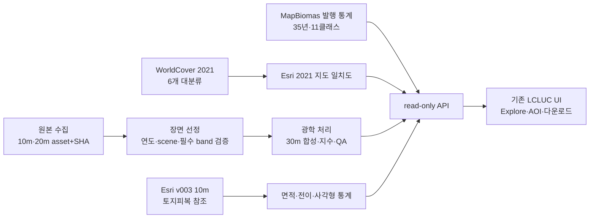

# 반텐 Sentinel-2 Explore Gate 이해자료

- updated_at: 2026-11-26 KST
- source_commit: `b8a8c52` + uncommitted worktree
- evidence_paths:
  - `docs/lcluc/SENTINEL_EXPLORER.md`
  - `services/lcluc/banten_sentinel_explorer.py`
  - `services/lcluc/banten_sentinel_statistics.py`
  - `services/lcluc/banten_historical_trend.py`
  - `services/lcluc/banten_product_agreement.py`
  - `services/api/lcluc_sentinel_explorer.py`
  - `frontend/src/LclucSentinelExplorer.tsx`
  - `frontend/src/LclucSentinelResults.tsx`
  - `frontend/src/ModelAnalysisWorkspace.tsx`
  - `artifacts/lcluc/sentinel-explore-e2e.log`
  - `artifacts/lcluc/sentinel-explore-browser.log`
  - `artifacts/lcluc/sentinel-explore-reference.log`
  - `artifacts/lcluc/sentinel-explore-change.log`
  - `artifacts/lcluc/sentinel-explore-swipe.png`
  - `artifacts/lcluc/sentinel-explore-aoi.png`
  - `artifacts/lcluc/sentinel-explore-published.log`
  - `artifacts/lcluc/sentinel-explore-final-e2e.log`
  - `artifacts/lcluc/sentinel-explore-pytest.log`
  - `artifacts/lcluc/sentinel-explore-final-build.log`
  - `artifacts/lcluc/sentinel-results-browser.log`
  - `artifacts/lcluc/sentinel-results-final.log`
  - `artifacts/lcluc/sentinel-layer-list-detail.png`
  - `artifacts/lcluc/sentinel-layer-bound-details-edge.log`
  - `artifacts/lcluc/sentinel-esri-source-edge.log`
  - `artifacts/lcluc/sentinel-layer-card-layout-edge.log`
  - `artifacts/lcluc/sentinel-aligned-results.png`
  - `artifacts/lcluc/sentinel-workspace-final-edge.log`
  - `data/curated/explorer/banten-province/mapbiomas-4.1-trend.json`
  - `data/curated/explorer/banten-province/esri-worldcover-2021-agreement.json`
- confidence: 발행·API·Edge 검증 `HIGH`; 독립 정확도·사업통계 승인 `NOT AVAILABLE`
- overall_status: `VERIFIED_REAL`

## 1. 쉬운 설명

### 한 문장으로

Sentinel-2 Explore는 보존 원본을 다시 내려받지 않고, 반텐 경계 안에서 연차 광학 영상·지수·품질과 Esri 토지피복 참조를 함께 보고 점 또는 사각형으로 조회·다운로드하는 읽기 전용 분석 화면이다.

### 기능과 자료 역할

이 Gate는 이미 수집한 Sentinel-2 L2A 원본을 읽어 다음을 만든다.

- 자연색 B04/B03/B02
- 컬러 적외선 B08/B04/B03
- NDVI, NDWI, NBR
- 구름·그림자·기타 관측 공백 QA
- 같은 해 Esri / Impact Observatory v003 토지피복 참조
- Esri 연도쌍의 유지·변화 layer
- 지도 한 점의 두 연도 밴드·지수·QA·참조 코드
- 반텐 전체 또는 사용자 사각형의 면적·비율·전이 CSV/JSON

이 Gate의 현재 역할은 Sentinel 광학 영상 탐색과 Esri 10m 참조 분류 집계다. 새 토지피복 분류의 생산 접수는 0건이고 독립 정확도는 `independent_accuracy_measured=false`로 미측정이다.

### 현재 확인된 범위

- `VERIFIED_REAL`: 실제 2020 API에서 서로 다른 PNG 6종과 30m·10-band 분석 GeoTIFF를 SHA 고정 응답으로 확인했다.
- `VERIFIED_REAL`: Edge에서 2020↔2025 영상 5조합, Esri·QA·변화 3중첩, 두 날짜 Explore, 사각 AOI와 CSV를 확인했다.
- `VERIFIED_REAL`: Esri 참조 2020~2025 6/6년과 가능한 모든 15/15 변화쌍을 발행·대조했다.
- `VERIFIED_REAL`: Sentinel 32장면에서 2020~2025 6/6년, 화면 PNG 36개와 30m 10-band GeoTIFF 6개 발행을 검산했다.
- `VERIFIED_REAL`: 시작 연도를 2024로 바꿔도 NBR 선택이 유지되고 정확한 2024→2025 변화 layer로 연결되는 것을 확인했다.
- `VERIFIED_REAL`: AOI 전이행렬의 합계와 선택한 `기준 클래스→비교 클래스` 방향만 표시하는 지도를 API로 확인했다. 사각형 AOI가 있으면 전이 PNG도 그 사각형과 반텐 경계로 잘린다.
- `VERIFIED_REAL`: MapBiomas Indonesia Collection 4.1 발행 통계에서 반텐 1990~2024 35개 연도·11개 클래스를 확인했다. 범위는 발행처의 반텐 주 단위 통계이며 사용자 AOI와 Esri 집계는 각각 별도 표로 제공한다.
- `VERIFIED_REAL`: 2021년 Esri v003와 ESA WorldCover v200을 10m 정합·6개 대분류로 비교해 926,628.52ha에서 지도 일치도 80.9456760515%를 확인했다. 독립 정확도는 미측정이다.
- `VERIFIED_REAL`: Edge 5175에서 면적표, layer 목록 접기·펼치기, 영상 조합 5개와 overlay switch 4개, 방향별 변화지도·순위 필터, 실제 AI 접수 상태, 35년 다운로드, 2021 제품 행렬을 클릭 확인했다.
- `VERIFIED_REAL`: 실제 결과 화면의 `AOI 지정`에서 지도 두 모서리를 클릭해 52,128.16ha가 결과표로 돌아오는 최종 경로를 확인했다.
- `VERIFIED_REAL`: Sentinel-2와 Landsat의 원본·QA 지원 현황은 제품 간 지도 일치도와 별도 표로 제공된다.
- `VERIFIED_REAL`: 입력·Expert 화면에서 Sentinel-2를 선택하면 상단 7개 이동 항목이 `지도 분석`과 6개 결과 제목으로 바뀐다. 실제 7개 항목이 각각 지도와 결과 카드로 초점·스크롤을 옮기는 것을 Edge 5175에서 확인했다.
- `VERIFIED_REAL`: 상단 결과·보고서 탭을 이동해도 지도 다음 형제 위치에 상세 패널 한 개와 AOI 52,128.16ha가 유지되는 것을 확인했다. Landsat·연차 Esri에서 패널이 해제되고 Sentinel-2 재선택 시 AOI가 복원됐다. `상세 결과` 버튼의 포커스 이동과 2024→2025 재계산 표 갱신도 확인했다.
- `VERIFIED_REAL`: 지도 오른쪽의 두 카드에 `연차 토지피복 주요 지표 (Banten)`과 `연차 토지피복 주요 전이`, Esri / Impact Observatory v003·반텐주 전체·2020→2025가 표시되는 것을 확인했다. Sentinel-2로 전환해도 지표·전이 수치가 유지됐고 지도 아래 AOI 출처 문구도 확인했다.
- `VERIFIED_REAL`: Sentinel-2 지도는 기존 연차 비교와 같은 2열 grid를 사용한다. 1650px Edge에서 두 모드의 지도 폭은 각각 886.95px였다. 오른쪽에는 클래스 면적·비율과 AI 신규 분류, 아래에는 전이행렬·세부 변화탐지·장기 추세·제품 간 검증을 배치했다. 920px에서는 결과 카드가 위아래로 쌓인다.
- `VERIFIED_REAL`: Swipe의 T1·T2에서 2022→2024를 선택해 API, 상단 필터, 지도, AOI 표가 같은 연도쌍으로 갱신되고 구분선이 50:50으로 돌아오는 것을 확인했다. 비교 연도는 기준 연도보다 뒤인 선택지만 제공한다.
- `VERIFIED_REAL`: Sentinel 범례는 영상 조합과 overlay 중심으로 정리했다. 점 조회는 지도 아래 AOI 도구에서 제공하고 행정경계 switch를 함께 표시한다. 연차 토지피복으로 돌아가면 기존 연차 조작부와 카드가 복원된다.
- `BLOCKED`: 독립 현장 정확도와 기관 승인 통계 해석.
- `BLOCKED`: 생산 연차 AI 실제 접수는 0건이며 실제 신규 분류·독립 검증 결과가 없다.

## 2. 이론적 배경

### 2.1 원본 해상도와 분석 격자는 다르다

Sentinel-2 원본은 같은 장면 안에서도 해상도가 다르다.

| 원본 | native 해상도 |
|---|---:|
| B02·B03·B04·B08 | 10m |
| B11·B12·SCL | 20m |

Explorer는 원본의 native 해상도와 SHA를 먼저 검사한 뒤, 모든 밴드와 SCL을 30m `EPSG:6933` 격자로 최근접 정합한다. 원본 해상도는 10m·20m이고 분석 공통 격자는 30m다.

### 2.2 연차 합성

같은 연도의 승인 장면을 관측일과 scene ID 순서로 정렬하고, 각 픽셀에서 여섯 밴드가 모두 존재하며 SCL이 4·5·6인 첫 관측을 선택한다. 이렇게 하면 같은 원본과 순서에서 반복 가능한 연차 합성이 만들어진다.

QA는 다음처럼 분리한다.

| QA | 뜻 |
|---:|---|
| 0 | 유효 합성 픽셀 |
| 1 | 잔여 구름 |
| 2 | 잔여 그림자 |
| 3 | 기타 관측 공백 |

### 2.3 분광 지수

- NDVI = `(B08-B04)/(B08+B04)` — 식생 반응
- NDWI = `(B03-B08)/(B03+B08)` — 수체 반응
- NBR = `(B08-B12)/(B08+B12)` — 연소·피해 탐색에 쓰는 분광 지수

음수 반사도나 분모가 0인 픽셀은 공백으로 둔다. NBR 한 장만으로 화재 원인이나 피해 등급을 확정하지 않는다.

### 2.4 광학 영상과 토지피복 참조의 역할

광학 영상·지수는 30m Sentinel 합성이다. 클래스 면적·비율·전이행렬과 분홍색 변화 layer는 Esri v003 10m 분류를 반텐 경계 안에서 집계한 것이다. 같은 화면에 겹쳐 보이지만 서로 다른 자료와 해상도를 가진다.

Esri 연도쌍 변화는 두 해에 모두 유효하고 클래스 코드가 다른 10m 픽셀이다. 공급자 자체 연차도 간 변화로 집계하며 독립 현장 정확도는 미측정이다.

### 2.5 사용자 사각형

사용자가 지도에서 맞은편 두 모서리를 고르면 WGS84 사각형을 반텐 경계와 교차시킨다. 통계 범위는 이 교집합이고 10m `EPSG:6933` 픽셀 중심 규칙으로 집계한다.

### 2.6 방향 전이와 단순 변화는 다르다

`산림→시가지`와 `시가지→산림`은 서로 다른 전이다. 전이행렬의 행은 기준 연도, 열은 비교 연도이며, 화면에서 한 셀을 고르면 API는 그 방향과 정확히 같은 픽셀만 표시한다. 단순히 두 연도의 코드가 다르다는 전체 변화 mask와도 구분한다. 사각형 AOI가 활성화되면 면적 합계뿐 아니라 선택 전이 PNG의 알파 mask도 같은 AOI로 절단한다.

### 2.7 장기 통계·제품 일치도·독립 정확도

- MapBiomas 35년 자료는 발행자가 제공한 반텐 주 단위 면적표다. 사용자 사각형 통계와 Esri 면적표는 각각 별도 범위로 제공한다.
- Esri↔WorldCover 비교는 두 지도를 같은 2021년·10m 격자와 6개 공통 대분류로 맞춘 지도 일치도다. 비교에서 제외된 crosswalk 영역 8,917.38ha를 분모에 넣지 않는다.
- WorldCover 비교 범위는 2021년 한 해다. 다른 연도에는 WorldCover 정답을 적용하지 않는다.
- 지도 일치도 80.9456760515%는 두 제품이 같은 대분류를 낸 비율이다. 현장 독립 표본 정확도는 미측정이다.

## 3. 코드·데이터 동작

### 3.1 다섯 단계를 구분한다

| 단계 | 담당 | 현재 해석 |
|---|---|---|
| 원본 수집 | 기존 Sentinel 수집·receipt | Explorer가 재수집하지 않음 |
| 장면 선정 | `scene_inputs` | 관측 연도, 필수 asset, 10m/20m native grid와 SHA 검사 |
| 광학 처리 | `banten_sentinel_explorer.py` | 30m 합성, PNG 6종, 10-band GeoTIFF, QA·지수 |
| Esri 분석 | `banten_sentinel_statistics.py` | 10m 참조 면적·비율·전이, 경계와 사용자 사각형 교차 |
| 장기 추세 | `banten_historical_trend.py` | MapBiomas 발행 workbook SHA 고정, 반텐 1990~2024 35년·11클래스 표 제공 |
| 제품 일치 | `banten_product_agreement.py` | Esri v003와 WorldCover v200의 2021년 10m·6대분류 교차행렬과 지도 일치도 계산 |
| API/UI | `lcluc_sentinel_explorer.py`, `LclucSentinelExplorer.tsx`, `LclucSentinelResults.tsx` | SHA 재검증 후 layer·점·통계·방향 전이·장기 추세·제품 비교·다운로드 제공 |

### 3.2 GeoTIFF와 PNG

분광 GeoTIFF의 10개 band 순서는 B02·B03·B04·B08·B11·B12·NDVI·NDWI·NBR·QA다. 분석 경계 밖은 NaN이다. 자연색·컬러 적외선·NDVI·NDWI·NBR·quality PNG는 화면 표시용 Web Mercator 파생본이다.

PNG는 빠른 화면 표시용이고, GeoTIFF는 30m 분석 격자·반사도·지수·QA를 보존한다. 둘을 같은 과학 산출물 형식으로 해석하지 않는다.

### 3.3 API

| 경로 | 역할 |
|---|---|
| `/api/lcluc/banten-sentinel-explorer` | 준비된 spectral·cover 연도와 변화쌍 목록 |
| `/years/{year}/layers/{layer}` | PNG 또는 spectral·land-cover GeoTIFF |
| `/years/{year}/metadata` | 원본 scene·asset SHA, 격자와 QA 기록 |
| `/change/{start}/{end}/{kind}` | Esri 변화 overlay PNG 또는 변화 GeoTIFF |
| `/point` | 두 연도의 밴드·지수·QA·Esri 코드 |
| `/statistics` | 반텐 전체 또는 `bbox` 교차 통계, JSON·CSV |
| `/transition/{start}/{end}` | `from_class`·`to_class` 방향 전이 PNG, 선택적 `bbox` 절단 |
| `/historical-trend` | MapBiomas 반텐 발행 통계 1990~2024·11클래스와 원문 정보 |
| `/product-support` | Sentinel/Landsat QA 현황과 2021 Esri↔WorldCover 지도 일치도를 별도 제공 |

API는 로컬 same-origin 읽기만 허용하고, 파일 byte와 저장 SHA가 다르면 409로 차단한다. 연도쌍은 2020≤기준<비교≤2025만 허용하고 bbox 범위·유한값을 검사한다.

### 3.4 UI

`Sentinel-2 L2A` layer 목록에서는 영상 조합 5개를 하나씩 고르고 Esri·변화·품질·행정경계 overlay 4개를 독립 switch로 켠다. 점 조회와 사각형 AOI 지정은 지도 아래 AOI 도구에서 제공한다. Sentinel 범례에는 행정경계 switch가 표시된다.

Sentinel-2 선택 시 상단 7개 이동 항목은 다음 목적지를 가리킨다.

1. `지도 분석`
2. `클래스 면적·비율`
3. `AI 신규 분류`
4. `전이행렬`
5. `세부 변화탐지`
6. `장기 추세`
7. `제품 간 검증`

각 항목을 누르면 같은 화면의 해당 카드로 스크롤하고 초점을 옮긴다. 여섯 결과 카드의 기능은 클래스 면적·비율, 실제 연차 접수 상태, 방향 전이, 세부 변화지도, MapBiomas 발행 반텐 35년·11클래스, 2021 Esri↔WorldCover 지도 일치도와 센서 QA다.

점 조회·AOI CSV/JSON·화면 PNG·30m spectral GeoTIFF·10m Esri GeoTIFF·변화 GeoTIFF 다운로드는 기존 기능으로 유지한다.

Sentinel-2가 지도 자료로 선택되면 지도 연도·AOI는 클래스 면적·비율·전이행렬·세부 변화탐지에 함께 적용된다. AI 신규 분류는 반텐 연차 작업 상태, 장기 추세는 MapBiomas 1990~2024 발행 반텐 전체, 제품 간 검증은 2021 반텐 전체를 표시한다. 2열 grid의 왼쪽에는 지도, 오른쪽에는 클래스 면적·비율과 AI 신규 분류가 놓인다. 전이행렬·세부 변화탐지·장기 추세·제품 간 검증은 지도 아래에 놓인다. 1650px Edge에서 연차 비교 지도와 Sentinel 지도 폭은 모두 886.95px였고 920px에서는 결과 카드가 위아래로 쌓였다.

Swipe bar의 T1은 기준 연도, T2는 비교 연도다. 비교 연도 선택지는 기준 연도 뒤로 제한하고, 변경 시 상단 필터·지도·AOI 결과·표를 함께 갱신한다. 연도 변경 뒤 구분선은 50:50 중앙으로 돌아온다. 연차 토지피복으로 돌아가면 기존 연차 조작부와 카드가 복원된다.

오른쪽 카드 두 개는 연차 토지피복 집계의 범위를 제목과 출처 문구로 고정한다.

- `연차 토지피복 주요 지표 (Banten)`
- `연차 토지피복 주요 전이`
- 공통 출처 문구는 Esri / Impact Observatory v003, 반텐주 전체, 선택한 기준 연도→비교 연도다.

지도 아래 Sentinel 패널은 자료 역할을 한 문장으로 안내한다. 영상·지수·품질은 Sentinel-2 L2A 자료다. 클래스 면적·비율과 전이행렬은 선택 AOI에서 집계한 Esri 연차 토지피복이다. API, 면적 산식, 전이 산식은 기존 검증 범위를 유지한다.

## 4. 시험·증거와 현재 상태

| 항목 | 상태 | 증거와 제한 |
|---|---|---|
| 2020 자연색·CIR·NDVI·NDWI·NBR·quality PNG | `VERIFIED_REAL` | API에서 서로 다른 6개 pinned PNG 응답 확인 |
| 2020 30m spectral GeoTIFF | `VERIFIED_REAL` | API에서 10-band 분석 TIFF와 SHA 응답 확인 |
| 10m/20m 원본→30m 정합·발행 | `VERIFIED_REAL` | native resolution·SHA 검사 후 32장면·6/6년·30m 10-band GeoTIFF 6개 발행·검산 |
| Sentinel 2020·2025 영상 5조합 | `VERIFIED_REAL` | Edge 자연색·CIR·NDVI·NDWI·NBR, 경계·범례·swipe 확인 |
| Sentinel 2020~2025 spectral materialization | `VERIFIED_REAL` | 32장면, 6/6년, 화면 PNG 36개, 30m 10-band GeoTIFF 6개 발행·검산 |
| Esri 10m 참조·변화 | `VERIFIED_REAL` | 2020~2025 6/6년, 가능한 15/15 연도쌍 발행·audit |
| Esri·QA·변화 3중첩 | `VERIFIED_REAL` | Edge에서 세 overlay와 class legend 확인 |
| Explore·사용자 사각형·CSV | `VERIFIED_REAL` | Edge 두 날짜 점 조회, 반텐 교차 AOI 53,155.27ha, 연차 전이 5개, CSV 112행 다운로드 |
| 통계·지수·GeoTIFF API | `VERIFIED_REAL` | 주 전체 pin 합계, 사용자 AOI 39,631.96ha, 비율·전이행렬·점·지수 공식·GeoTIFF download 확인 |
| 연도 선택 UI | `VERIFIED_REAL` | 시작 연도를 2024로 변경해 NBR 선택 유지와 정확한 2024→2025 변화 layer 연결 확인 |
| 방향 전이·AOI 절단 단위시험 | `TESTED_SYNTHETIC` | `기준 2→비교 7`과 역방향을 구분하고 bbox 밖 알파를 0으로 만드는 fixture 통과 |
| AOI 전이 합계·방향 전이 PNG API | `VERIFIED_REAL` | 전이행렬 합계와 선택 클래스쌍을 대조하고, 사각형과 반텐 경계로 잘린 PNG 확인 |
| MapBiomas 장기 추세 | `VERIFIED_REAL` | pinned 발행 workbook, 반텐 주 통계 1990~2024 35년·11클래스; 사용자 AOI·Esri 통계는 별도 |
| 2021 Esri↔WorldCover 지도 일치도 | `VERIFIED_REAL` | 10m·6대분류, 비교 926,628.52ha, 80.9456760515%; 8,917.38ha crosswalk 제외 |
| 결과·layer UI 클릭 | `VERIFIED_REAL` | Edge 5175에서 면적표, 접기·펼치기, 5영상·4 switch, 방향 지도·필터, AI 상태, 35년 다운로드, 2021 행렬 확인 |
| 결과 화면 AOI 지정 | `VERIFIED_REAL` | 지도 두 모서리 클릭 뒤 52,128.16ha 결과표 반환; `sentinel-results-final.log` |
| Sentinel 상단 7개 이동 항목 | `VERIFIED_REAL` | 지도 분석과 6개 결과 제목을 실제 클릭해 각 대상 카드의 초점·스크롤과 실자료 내용을 확인 |
| 상단 탭 독립·자료 전환·위치 이동 | `VERIFIED_REAL` | 패널 한 개·AOI 52,128.16ha 유지, Landsat·Esri에서 해제, Sentinel 재선택 시 AOI 복원, 포커스 이동, 2024→2025 표 갱신 확인 |
| 카드·Sentinel 패널 출처 표기 | `VERIFIED_REAL` | Edge에서 두 카드의 Esri v003·반텐주 전체·2020→2025, 기반자료 전환 후 수치 유지, Sentinel 광학·Esri AOI 출처 문구 확인 |
| Sentinel 2열 지도·6카드 배치 | `VERIFIED_REAL` | 1650px에서 연차·Sentinel 지도 폭 각각 886.95px, 오른쪽 2카드·하단 4카드, 920px 세로 배치 확인 |
| Swipe T1/T2 연도 결속 | `VERIFIED_REAL` | 2022→2024 변경 시 API·상단 필터·지도·AOI 표 동시 갱신, 유효 연도 선택지와 50:50 복귀 확인 |
| 범례·AOI 도구·행정경계 | `VERIFIED_REAL` | 범례 보조 영역 정리, AOI 도구의 점 조회, 행정경계 switch DOM과 연차 화면 복원 확인 |
| Sentinel/Landsat QA 지원표 | `VERIFIED_REAL` | 두 센서의 원본·연차 QA를 제품 일치도와 분리해 조회 |
| 생산 연차 AI 신규 분류 | `BLOCKED` | 실제 운영 접수 0건; 후보 모델·독립 검증·release 없음 |
| Esri 독립 정확도 | `BLOCKED` | `independent_accuracy_measured=false`; 현장·전문가 독립 표본 없음 |
| 사업통계 승인 | `BLOCKED` | One Map 경계 `PROJECT_STATISTICS_PENDING` |

발행 검산은 Sentinel 6/6년과 Esri 6/6년·15/15쌍을 모두 확인했다. 최종 Edge/HTTP 시험은 exit 0이었고, 시작 연도 변경 시 spectral mode를 유지하면서 해당 연도쌍의 정확한 변화 layer를 고르는 경로까지 확인했다. 사람의 클릭 검증 범위는 대표 연도 선택 경로이며 15쌍 완전성은 발행 audit로 확인했다.

LCLUC 시험 묶음은 최종 `44 passed, 2 skipped`였고, Edge 최종 재실행에서는 14px switch를 포함한 첨부형 layer 목록과 결과 화면 AOI 52,128.16ha 반환을 확인했다.

출처 표기 개정은 `sentinel-esri-source-edge.log`에서 실제 확인했고 frontend build도 통과했다. API와 산식은 기존 검증 결과를 그대로 사용한다.

## 5. 발표 스크립트

### 1분

“반텐 Sentinel-2 Explore는 기존 연차 비교와 같은 2열 지도 폭을 사용합니다. 오른쪽에는 클래스 면적·비율과 AI 신규 분류, 아래에는 전이행렬·세부 변화탐지·장기 추세·제품 간 검증이 배치됩니다. 상단의 지도 분석과 여섯 결과 제목을 누르면 해당 카드로 바로 이동합니다. Swipe의 T1·T2 선택은 상단 필터·지도·AOI 표에 함께 적용되고 구분선은 50:50으로 정렬됩니다. 영상·지수·품질은 Sentinel-2 L2A이며 면적·비율·전이는 Esri 연차 토지피복 집계입니다. 독립 정확도는 미측정이고 생산 연차 AI 실제 접수는 0건입니다.”

### 5분

1. Explorer는 원본을 재수집하지 않고 보존 원본과 receipt를 읽는다.
2. B02·B03·B04·B08은 10m, B11·B12·SCL은 20m native grid를 검사한다.
3. 모든 자료를 30m EPSG:6933에 최근접 정합한다.
4. 날짜·scene ID 순서에서 여섯 밴드와 SCL 4·5·6을 만족하는 첫 픽셀을 연차 합성한다.
5. 자연색·CIR·NDVI·NDWI·NBR·QA를 PNG와 10-band GeoTIFF로 만든다.
6. Esri 10m 참조는 Sentinel 분류 결과가 아니라 별도 연차 토지피복이다.
7. 사용자 사각형은 반텐 경계와 교차한 부분만 10m 픽셀 중심 규칙으로 집계한다.
8. API는 파일 byte·SHA를 다시 검사하고 점·통계·CSV·GeoTIFF를 읽기 전용으로 제공한다.
9. 연도 선택을 2024로 바꿔 NBR 상태 유지와 정확한 2024→2025 변화 layer 연결을 실제 확인했다.
10. 전이행렬 셀과 순위는 방향을 보존하고, 사각형 사용 시 선택 전이 PNG도 같은 AOI로 절단한다.
11. MapBiomas는 발행자 주 단위 35년 통계이며 Esri·사용자 AOI와 섞지 않는다.
12. WorldCover 비교 범위는 2021년 6개 대분류 지도 일치도이며 독립 정확도는 미측정이다.
13. Sentinel/Landsat QA, 제품 지도 일치도, 생산 연차 AI 접수 상태를 서로 다른 표로 보여 준다.

## 6. Q&A

**Q. Sentinel-2 원본을 30m로 수집한 것입니까?**

원본은 native 10m·20m로 보존한다. Explorer 분석본만 30m 공통 격자로 정합한다.

**Q. 자연색과 NDVI는 같은 파일입니까?**

화면 PNG는 조합별 표시 layer로 분리된다. 분석 GeoTIFF에는 여섯 반사도 band, 세 지수와 QA가 정해진 10-band 순서로 함께 들어간다.

**Q. 변화탐지는 Sentinel 지수 변화입니까?**

현재 분홍색 변화 layer와 전이 통계는 두 Esri v003 연차 분류 코드가 다른 10m 픽셀이다. Sentinel 광학 영상은 같은 화면의 별도 탐색 자료다.

**Q. Esri 통계가 독립 정확도입니까?**

Esri 통계는 같은 공급자의 연차 참조 집계다. 독립 정확도는 `independent_accuracy_measured=false`로 미측정이다.

**Q. 사용자가 그린 사각형 전체가 통계 면적입니까?**

통계 범위는 사각형과 반텐 경계의 교집합이다. 10m equal-area 픽셀 중심 규칙으로 계산한다.

**Q. 현재 2020~2025 전체 Sentinel 분광 파생을 검증했습니까?**

발행과 핵심 UI는 완료됐다. Sentinel 32장면에서 2020~2025 6/6년, PNG 36개와 30m GeoTIFF 6개를 검산했고 Esri도 6/6년·15/15쌍이다. 시작 연도를 2024로 바꿔 NBR 상태와 정확한 2024→2025 변화 연결도 확인했다. 사람의 클릭 검증은 대표 선택 경로, 15쌍 완전성은 발행 audit 근거다.

**Q. 전이행렬에서 산림→시가지와 시가지→산림은 같은 지도입니까?**

두 지도는 기준 연도→비교 연도의 방향을 각각 보존한다. 사각형 AOI가 있으면 면적 합계와 선택 전이 PNG 모두 같은 AOI로 제한된다.

**Q. MapBiomas 35년 통계도 사용자가 그린 사각형 통계입니까?**

MapBiomas Indonesia Collection 4.1 발행자가 제공한 반텐 주 단위 1990~2024 통계다. 사용자 AOI·Esri 면적표는 별도 출처와 범위로 표시한다.

**Q. Esri↔WorldCover 80.9456760515%는 모델 정확도입니까?**

이 값은 2021년 두 지도 제품을 10m·6개 대분류로 맞춘 926,628.52ha의 지도 일치도다. WorldCover 적용 범위는 2021년이며, 독립 현장 표본 정확도는 미측정이다.

**Q. AI 신규 분류 탭에 결과가 있습니까?**

탭과 상태 계약은 연결됐고 생산 연차 AI 실제 접수는 0건이다. 실제 신규 분류·독립 정확도·release 상태는 `BLOCKED`다.

**Q. Sentinel 결과 카드로 빠르게 이동하려면 어떻게 합니까?**

Sentinel-2를 선택하면 상단 7개 항목이 지도 분석과 여섯 결과 제목으로 바뀐다. 항목을 누르면 해당 지도나 카드로 스크롤하고 초점을 옮긴다. 실제 7개 경로와 여섯 실자료 카드 내용을 Edge 5175에서 확인했다.

**Q. `상세 결과` 버튼은 패널을 열고 닫습니까?**

버튼은 이미 표시된 지도 아래 상세 결과 위치로 초점과 스크롤을 옮긴다. 같은 연도와 AOI 상태가 지도와 결과에 함께 적용된다.

**Q. Landsat이나 연차 Esri로 바꾸면 어떤 화면이 보입니까?**

Sentinel 상세 패널의 렌더링 조건은 Sentinel-2 선택에 결속돼 있다. Landsat과 연차 Esri 전환 시 패널이 해제되고 Sentinel-2 재선택 시 AOI가 복원되는 것을 Edge에서 확인했다. 실제 결과·보고서 상단 탭을 이동해도 패널은 한 개로 유지됐고 2024→2025 재계산 표가 갱신됐다.

**Q. 오른쪽 주요 지표와 주요 전이 카드는 어떤 자료입니까?**

두 카드는 Esri / Impact Observatory v003 연차 토지피복의 반텐주 전체 집계다. 카드에는 선택한 기준 연도와 비교 연도쌍을 함께 표시한다.

**Q. 지도 아래 Sentinel 패널의 수치는 어떤 자료를 사용합니까?**

영상·지수·품질은 Sentinel-2 L2A 자료를 사용한다. 클래스 면적·비율과 전이행렬은 선택한 AOI의 Esri 연차 토지피복을 집계한다. 현재 개정은 출처 설명을 명확히 하며 API와 산식은 기존 검증 범위를 유지한다.

**Q. Sentinel-2 결과 카드는 어떻게 배치됩니까?**

지도는 기존 연차 비교와 같은 2열 폭을 사용한다. 오른쪽에는 클래스 면적·비율과 AI 신규 분류가 놓이고 아래에는 전이행렬·세부 변화탐지·장기 추세·제품 간 검증이 놓인다. 1650px에서는 두 지도 폭이 각각 886.95px였고 920px에서는 결과 카드가 세로로 쌓였다.

**Q. T1과 T2를 바꾸면 어느 결과가 갱신됩니까?**

T1 기준 연도와 T2 비교 연도는 상단 필터·지도·AOI 결과와 클래스 면적·비율·전이행렬·세부 변화탐지에 함께 적용된다. AI 신규 분류는 반텐 연차 작업 상태, 장기 추세는 MapBiomas 1990~2024 반텐 전체, 제품 간 검증은 2021 반텐 전체를 제공한다. 비교 연도는 기준 연도보다 뒤인 선택지로 제공되고 변경 뒤 swipe 구분선은 50:50 중앙으로 돌아온다. Edge에서 2022→2024 갱신을 확인했다.

**Q. 점 조회와 행정경계는 어디에서 사용합니까?**

점 조회는 지도 아래 AOI 도구에서 사용한다. 행정경계는 Sentinel 범례의 switch로 표시를 조절한다. 최종 Edge 통합에서 두 control의 DOM과 실제 화면 배치를 확인했다.
